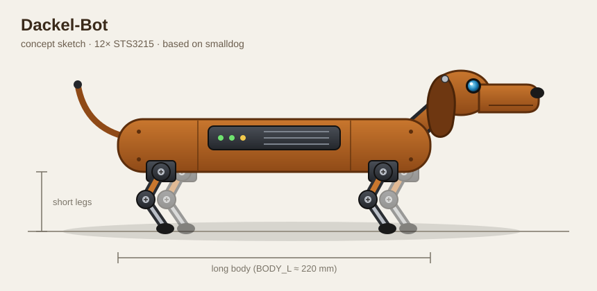

# Dackel-Bot: dachshund variant of smalldog

Base: [alarin/smalldog](https://github.com/alarin/smalldog), a 12-DOF printed quadruped on 12× ST3215/STS3215 bus servos.
This fork is the dachshund; the original geometry lives upstream and in `git log`.



> The sketch shows the idea, not the robot: there is no head, neck or tail in the CAD.
> No dachshund hardware exists yet. Every number below is from the CAD and the simulation.
> No license was visible on the upstream repo page: check before publishing a derivative.

## 1. What the robot is now

| | original | dachshund |
|---|---|---|
| body length `BODY_L` | 126 mm | 220 mm |
| hips `ROLL_X` / `PITCH_X` | ±90 mm | ±137 mm (wheelbase 274 mm) |
| thigh `L_THIGH` | 75 mm | 75 mm |
| shin `L_SHIN` | 82 mm | 55 mm, solid |
| stand pose (thigh / knee) | −22° / 46° | −30° / 73° |
| body height standing | 187 mm | 148 mm |
| mass | 2.55 kg | 2.32 kg |
| sensors | LiDAR, GPS, camera, IMU | camera, IMU |

**Why the thigh did not shorten.** The knee servo sits inline in the thigh with its connector
towards the hip. At 75 mm the connector-and-cable keep-out exactly clears the hip bracket's
pitch sleeve; at 72 mm it already cuts 488 mm³ out of that sleeve's end wall and thrust lug.
A shorter thigh needs a different knee architecture. The low stance comes from the short shin
and a deeper crouch instead.

## 2. Parts

| Part | Notes |
|---|---|
| 12× ST3215 / STS3215, 12 V (30 kg·cm) | with aluminium hubs |
| Feetech URT-1 | programs servo IDs before assembly |
| USB-serial bus adapter | FTDI-based |
| Orange Pi 5 Pro, in its case | runs the 50 Hz runtime; the IMU is taped inside the case |
| 3S2P 21700 pack + BMS | cased module in the middle of the tray |
| BMI088 IMU (I2C) | required by the RL policy's observation |
| IMX415 USB camera module | in the nose, on two deck bolts |
| XL4015 buck 12 → 5 V | on the Pi's case top |
| PETG/ASA filament, TPU for the feet | whole structure is printed |

Fastener and BOM detail: `3d/README.md`.

## 3. State of the work

| step | state |
|---|---|
| CAD (`3d/mini_dog.py`) | done: builds clean, every clearance probe green |
| FEA (`3d/fea.py --all`) | done; weakest inter-layer SF: `cradle_front` 0.9 at the 3 g landing, `thigh_A` 1.1 at stall (both as on the original). The 220 mm tray reads 3.5 |
| sim models | done: both exporters stand four feet down at 148 mm |
| hand-tuned trot | done: 557 mm in 5 s flat; terrain seeds 7…12 all upright, 387…548 mm |
| RL environment | adapted; `rl/checks/check_model.py` 0 FAIL |
| **RL policy** | **not trained.** Needs a CUDA GPU: `WSL.md` / `GPU.md` |
| hardware | nothing bought, nothing printed |

## 4. Rebuild and check

Run from a Linux shell (WSL2). The whole ladder is in `3d/CLAUDE.md`, "Verifying a change".

```bash
cd 3d
.venv/bin/python mini_dog.py             # out/step, out/stl, out/bom.json
.venv/bin/python render.py               # out/view_*.png
.venv/bin/python fea.py --all            # strength check, after every change
.venv/bin/python export_sim.py --check   # out/sim/ URDF + MJCF
cd ../ros2
../3d/.venv/bin/python smalldog_description/scripts/generate_model.py
../3d/.venv/bin/python tools/standalone_sim.py --headless
../3d/.venv/bin/python tools/standalone_sim.py --headless --terrain
../3d/.venv/bin/python tools/standalone_sim.py --course
```

The venv needs `cadquery sfepy gmsh scipy pillow meshio vtk numpy` and `mujoco==3.12.0`
(the version `rl/uv.lock` pins; 4.x gives different contact results).

## 5. Train the walking policy

No policy exists for this body. The old one was removed: the action is an offset from the
stand pose, so it cannot be fine-tuned across.

```bash
cd rl
uv sync --extra cuda                     # WSL2 + NVIDIA GPU, 8 GB VRAM minimum
uv run python checks/check_model.py      # exit 0, or do not train
python train_ppo.py                      # from scratch, no --init-from
python eval.py runs/<name>
python replay.py runs/<name>/ckpt/*/ --robots 96
python export_onnx.py runs/<name> --out policy
```

Commit `rl/policy/` (`policy.onnx` + `policy.json`): git is the only thing that crosses
machines. `robot/runtime/policy.py` refuses a policy whose stance differs from
`robot_params.json`.

## 6. Print and assemble

1. Print the parts from `3d/out/stl/` (already in print orientation). The tray and deck are
   220 × 92 mm and need a 256 mm bed.
2. Program the servo IDs with the URT-1 **before** assembly.
   ID = `<leg><joint>`: 11–13 front left, 21–23 front right, 31–33 rear right, 41–43 rear
   left; joints counted down the leg.
3. Assemble with the legs straight down (mechanical zero).

## 7. Bring-up

```bash
cd robot
python feetech/bus.py --scan           # all 12 IDs visible?
python runtime/calib.py --ids
python runtime/walk.py --preflight     # nothing moves
python runtime/calib.py --capture      # zero offsets, repeat after reassembly
python runtime/calib.py --sign all     # moves each joint 8.6°
python runtime/walk.py --stand
python runtime/walk.py --go 5          # walk straight for 5 s
```

`robot/runtime/calib.json` carries its own soft limits and they win over
`robot_params.json`: re-capture it for the new robot rather than reusing the old file.

## Open points

- **Ground obstacles.** The tuned trot swings the foot 12 mm. On two of three course seeds
  it stalls at a 14 mm log instead of stepping over it. The RL policy is expected to do
  better; until then door sills are a problem.
- **Centre of mass.** The CAD puts it at the hip centre. The original robot measured 25–40 mm
  ahead of its CAD, so weigh the dachshund on a scale and correct `stance_x` and
  `com_offset_m_abs` in `rl/params/domain_rand.json`.
- **Wiring.** The front leads run 47 mm further. The original already showed checksum errors
  on two rear-leg leads under torque (`robot/README.md`).
- **Turning.** The wheelbase grew by half; the turn rates fitted on the original
  (`robot.launch.py`, `FIT`) are unverified.
- **Navigation.** `smalldog_nav`, `cloud_to_scan` and `robot/slam` are still in the tree but
  need a LiDAR this robot does not carry.
